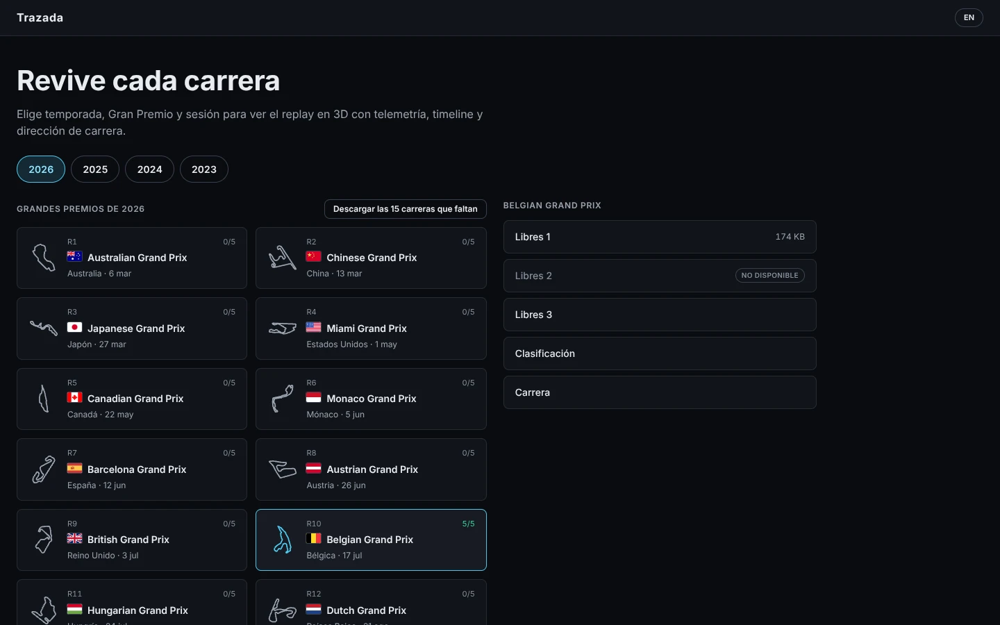
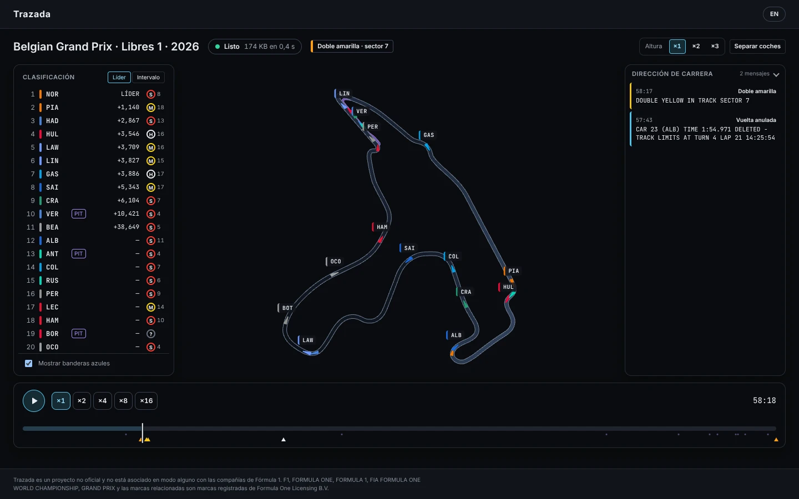
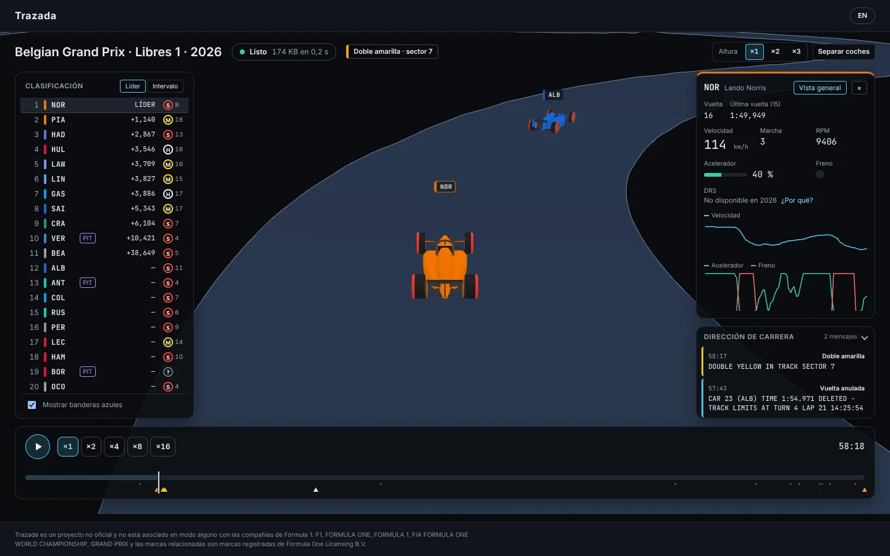
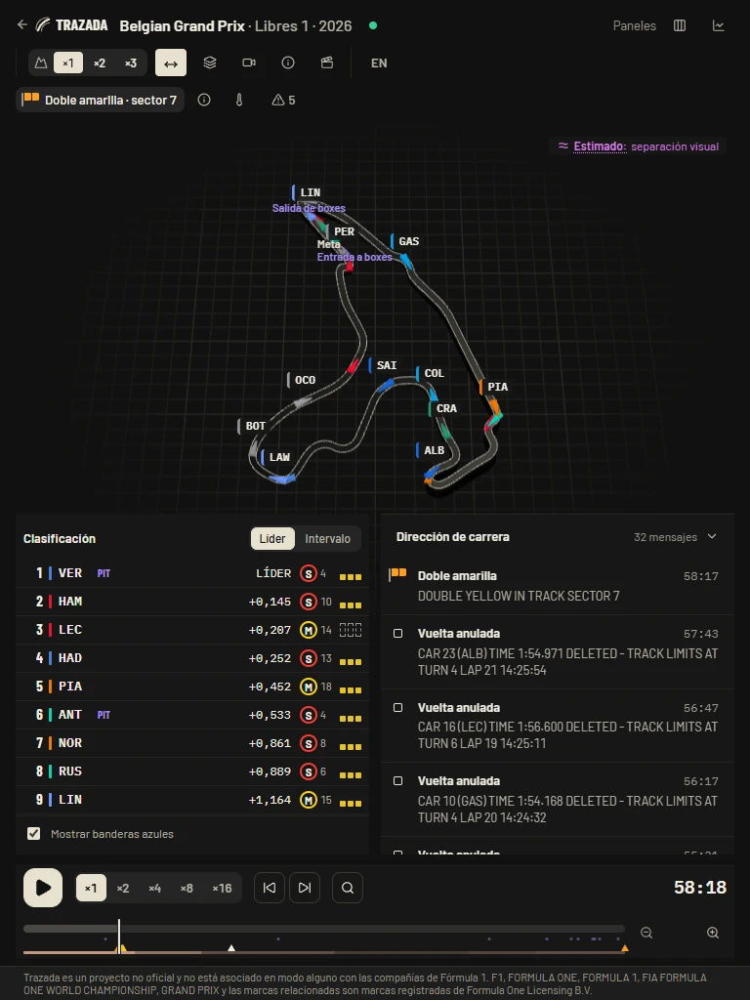

# Trazada

Replay y análisis de carreras: circuito en 3D con todos los coches en movimiento, timeline, telemetría y dirección de carrera, sincronizados con un único reloj. Web estática, coste cero.

> **Proyecto no oficial.** Trazada es un proyecto no oficial y no está asociado en modo alguno con las compañías de Fórmula 1. F1, FORMULA ONE, FORMULA 1, FIA FORMULA ONE WORLD CHAMPIONSHIP, GRAND PRIX y las marcas relacionadas son marcas registradas de Formula One Licensing B.V.
>
> *Trazada is unofficial and is not associated in any way with the Formula 1 companies. F1, FORMULA ONE, FORMULA 1, FIA FORMULA ONE WORLD CHAMPIONSHIP, GRAND PRIX and related marks are trade marks of Formula One Licensing B.V.*

## Cómo se ve

Es una app para usar en tu PC (no hay web pública), así que aquí van unas capturas. Muestran el extracto de prueba que viene con los tests: nueve minutos reales de Libres 1 de Spa 2026, con la clasificación y los mensajes de dirección de carrera de ese momento (ver [`DATA_NOTICE.md`](DATA_NOTICE.md)). En la portada, el calendario es el real de la temporada; las sesiones de Bélgica marcadas DEV o «no disponible» son variantes de prueba de los tests.

**Portada**: el calendario de cada temporada, con la bandera y el trazado de cada Gran Premio. Cada sesión ya disputada se descarga con un clic, en tu PC.



**Replay**: el circuito en 3D con todos los coches en movimiento, la clasificación en vivo (gaps, neumáticos, boxes), la dirección de carrera, las banderas por sector y el timeline con sus marcas.



**Siguiendo a un coche**: monoplaza 3D genérico con el color de su equipo y el compuesto en los neumáticos, cámara de seguimiento con zoom (rueda o pellizco), telemetría y gráficas de los últimos segundos.



**Tablet**: con `pnpm local --lan`, también en el iPad (paneles abajo en vertical).



Las capturas se regeneran con `pnpm build && README_SHOTS=1 pnpm e2e readme-shots`.

## Qué hace

- Replay 3D de cualquier sesión (libres, clasificación, sprint, carrera) de 2023 en adelante, con un único reloj para todo: coches, clasificación, telemetría y mensajes. Velocidades de ×1 a ×16 y saltos a cualquier instante.
- Clasificación en vivo con gap al líder o intervalo, compuesto y vueltas del neumático, boxes y banderas azules. Cuando cambia el orden, las filas se deslizan y llevan unos segundos una flecha ↑↓ con los puestos ganados o perdidos.
- Estelas opcionales detrás de cada coche (menú «Capas»), con el color del equipo o el de la velocidad medida.
- Al terminar la sesión, un resumen: los tres primeros según el cronometraje, la vuelta rápida y, en carrera, las paradas con su tiempo en el pit lane.
- Cada sesión se retoma donde la dejaste, con el coche y la velocidad que tenías, y la portada ofrece «Seguir viendo» (se guarda en el navegador de cada dispositivo).
- Telemetría del coche elegido (velocidad, marcha, RPM, acelerador, freno) y cámara que lo sigue.
- Dirección de carrera, banderas por sector en el mapa y tinte de pista con coche de seguridad, VSC o bandera roja.
- Datos honestos: lo que se estima se marca como «Estimado» y lo que falta se muestra como «sin dato».
- En español e inglés, tema oscuro, escritorio y tablet.

## Qué es dato y qué es modelo

El replay mezcla datos de la fuente con un modelo para dibujarlos. En la app lo explica el botón «Cómo se dibuja», junto a las herramientas del mapa; los avisos que deja el pipeline al procesar una sesión salen en la cabecera del replay.

**Dato de la fuente**

- La posición de cada coche (x, y y altura), unas 4 veces por segundo.
- Tiempos de vuelta, neumáticos, telemetría y mensajes de dirección de carrera, del cronometraje.

En una sesión de desarrollo (fuente secundaria) parte de esto está reconstruido: la app lo marca como «Estimado», también en «Cómo se dibuja».

**Modelo (solo para dibujar)**

- Entre una posición y la siguiente, el movimiento se interpola. Si pasan más de 2 s sin posición, el coche no se dibuja en ese hueco.
- La fuente no indica en qué parte del ancho de la pista va cada coche. Por eso se dibuja sobre la línea central, según la distancia recorrida y con el morro en la dirección de la pista. Si la fuente lo sitúa a menos de 30 m de la línea central (por ejemplo, en la grava), se dibuja sobre la pista; más lejos, el coche se oculta.
- En boxes (entre la entrada y la salida que da el cronometraje, y cerca de ellas cuando la posición está más cerca del pit lane que de la pista), el coche se dibuja sobre la línea del pit lane; en el garaje, se oculta.
- Un coche nunca se dibuja marcha atrás: si la fuente lo sitúa retrocediendo (ruido o un trompo), la distancia recorrida se ajusta para que no disminuya. Si ese ajuste tuviera que moverlo más de 5 m, o la telemetría dice que iba en marcha mientras la posición seguía congelada, ese tramo queda sin dato y el coche no se dibuja.
- La pista tiene una anchura genérica de 14 m, no la de cada circuito. De lejos, la pista y los coches tienen un tamaño mínimo en pantalla.
- El coche 3D es genérico: lleva el color del equipo y, en los neumáticos, el del compuesto que da el cronometraje (gris si no hay dato).
- Las estelas son los últimos 3 s del mismo movimiento que se dibuja para el coche, así que también van sobre la línea central y se cortan donde el coche no se dibuja. Por velocidad, cada punto lleva la última velocidad medida de hace 2 s como mucho, sin interpolar; si no hay ninguna, gris.
- Lo que se calcula o se exagera (altura ×2 o ×3, separar coches, vuelta 1…) lleva la etiqueta «Estimado».

## Estado

En desarrollo (Fase 1, MVP replay). Plan, decisiones e hitos en [`docs/PLAN.md`](docs/PLAN.md). La fuente de verdad del proyecto es [`docs/BRIEF.md`](docs/BRIEF.md).

## Estructura

| Ruta | Qué es |
|---|---|
| `apps/web` | App Nuxt 4 + TresJS v5 (estática, `nuxt generate`) |
| `packages/schema` | Esquema de datos compartido (JSON Schema, layouts TRZB, tipos TS) |
| `pipeline` | Pipeline Python (FastF1) que genera los ficheros de cada sesión |
| `docs` | Brief, plan, formato de datos, rendimiento e investigación |

## Requisitos

- Node 24 LTS (ver `.nvmrc`) y pnpm 12
- Python 3.13 y [uv](https://docs.astral.sh/uv/)

## Comandos

```bash
pnpm install            # dependencias del front y del esquema
pnpm dev                # servidor de desarrollo (datos locales en /data)
pnpm lint && pnpm typecheck && pnpm test
pnpm build              # nuxt generate → apps/web/.output/public
pnpm e2e                # Playwright sobre el estático generado

cd pipeline
uv sync
uv run trazada --help
uv run ruff check && uv run pytest
```

## Datos

Los datos de F1 no forman parte de este repositorio ni de su licencia: ver [`DATA_NOTICE.md`](DATA_NOTICE.md) (las miniaturas de trazado son de bacinger/f1-circuits, MIT). Es un proyecto **personal**: los datos se generan en tu PC con el pipeline (IP residencial) y **no se publican**. Para usar la app con ellos:

```bash
cd pipeline && uv sync && cd ..   # una vez: entorno del pipeline
pnpm local          # http://127.0.0.1:3000 con los datos de data/
pnpm local --lan    # también en tu red de casa (p. ej. el iPad)
```

En la portada verás el calendario de cada temporada. Cada sesión ya disputada tiene un botón **Descargar**: ejecuta el pipeline en tu PC (FastF1, con tu conexión de casa), muestra el progreso y, al terminar, la sesión se puede abrir. También puedes descargar de una vez lo que falta de un Gran Premio o todas las carreras que faltan de la temporada. Las descargas solo se pueden lanzar desde el propio PC, no desde otros dispositivos de la red. La caché de FastF1 (`.cache/`) ocupa bastante más que los datos generados; se puede borrar sin perder nada.

Todo se usa en local: no hay despliegue (decisiones D25 y D26 en `docs/PLAN.md`).

## Rendimiento

Objetivos, método (`/replay?s=…&bench=1`) y cifras en [`docs/PERFORMANCE.md`](docs/PERFORMANCE.md).

## Licencia

Código bajo licencia MIT ([`LICENSE`](LICENSE)). Terceros en [`NOTICE`](NOTICE).
